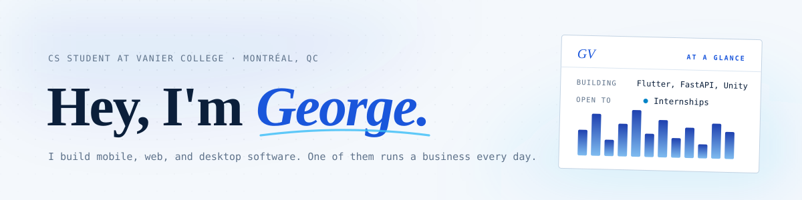

<picture>
  <source media="(prefers-color-scheme: dark)" srcset="https://raw.githubusercontent.com/gvogas/gvogas/main/assets/readme-banner-dark.svg" />
  
</picture>

  <a href="https://gvogas.github.io/gvogas/"><strong>Explore my portfolio</strong></a> &nbsp; / &nbsp;
  <a href="https://www.linkedin.com/in/georgevogas/">LinkedIn</a> &nbsp; / &nbsp;
  <a href="https://devpost.com/Terminator320">Devpost</a>

CS student at Vanier College · Building software people use · Open to internships

I learn by making things: a scheduling app a company uses every day, a student tracker my classmates use, a ticketing platform built with my team, and an iPhone budgeting app on its way to the App Store.

---

## Things I've built

From a client commission to team projects and experiments.

### ES Pro

Featured project · Mobile · Commissioned, in daily use · 🔒 Private repo (client code)

A commissioned app that replaced a service company’s paper schedule with a shared calendar, client directory, and employee workflows. In daily use since handover.

<code>Flutter</code> <code>Firebase</code> <code>Google Places API</code> <code>Dart</code> <code>Android</code> <code>iOS</code>

Inside the build

- Real-time appointment calendar with per-employee color coding and admin/employee role separation
- Full client directory with accent-insensitive search across large record sets
- In-app photo capture, auto-compression, and background upload to Firebase Storage
- Invite-only employee onboarding: admin creates the account first, and only pre-whitelisted emails can register
- Light/dark mode, text scaling, and multi-language support, all persisted across sessions
- Google Places API for address autocomplete on client records

Feature-first folder structure, with all database access going through per-feature service
classes so that screens never query Firestore directly, behind a single centralized route
handler. I'm currently adding Wave billing: completed appointments auto-generate invoices,
sync client records, and surface payment status in the app.

---

### [Term](https://github.com/gvogas/medDashboard)

Web app · Solo · Live, 700+ commits

A student tracker for courses, timetables, deadlines, grades, and study time, used by a small group of classmates. It works offline and syncs when you're back online. [Live site](https://rounds.termanitor07.workers.dev)

<code>TypeScript</code> <code>React</code> <code>Tailwind</code> <code>Cloudflare Workers</code> <code>D1 (SQLite)</code> <code>IndexedDB</code> <code>Workers AI</code> <code>Vitest</code>

Inside the build

- An "Up next" list ranks what to work on now and says why ("Exam in 4 days · worth 30% · 8 topics left")
- Grade math: weighted categories, drop-lowest rules, "what if" scores, and GPA by semester on an editable scale
- Shared classes and team projects with owner/editor/member roles, invites, an inbox, and an activity feed
- AI import reads course outlines, school calendars, and timetable screenshots, then shows a preview before anything is saved
- Private calendar feed for Google or Apple Calendar, morning push digests, undo, and JSON/CSV export
- Admin page with accounts, error and audit logs, and per-feature maintenance switches

Local-first: the UI reads from IndexedDB and syncs to a Worker API on D1. Pushing to `main`
runs typecheck, tests, and build, applies new migrations to the live database, and deploys
through GitHub Actions, with a separate staging site for trying a branch first.

---

### [TicketMaestrix](https://github.com/gvogas/Ticketmaestrix)

Web platform · Team of three

An event ticketing platform built with Fadwa Shalby and Lucas Coveyduck. Customers browse events and buy tickets; admins manage inventory and sales. It was deployed to cPanel through GitHub Actions.

<code>PHP</code> <code>Twig</code> <code>Slim MVC</code> <code>MySQL</code> <code>GitHub Actions</code> <code>cPanel</code>

Inside the build

- User accounts with event browsing, ticket purchase, and order history
- Admin dashboard for event creation, ticket inventory control, and transaction monitoring
- Built on a custom Slim MVC framework with Twig templating, no off-the-shelf CMS
- Internationalization support via a `/translations` directory
- CI/CD pipeline via GitHub Actions, deploying to cPanel on push

## More things I've made

### [Headroom](https://gvogas.github.io/Spending-Tracker-pages/)

iPhone app · Solo · Coming soon to the App Store

An iPhone app that answers one question: how much can I safely spend before payday? Enter your balance, payday, and bills, and it gives you a number per day. No account, no bank login, and nothing leaves the phone.

<code>iOS</code> <code>watchOS</code> <code>Widgets</code> <code>Siri &amp; Shortcuts</code> <code>Face ID</code>

Inside the build

- Safe to spend = balance − bills due before payday − set-asides, divided by the days left, kept in exact cents
- "Can I spend this?" check that recalculates with bills and savings protected and answers in a sentence
- Home-screen widget, Apple Watch complications, and Siri logging with no setup
- Face ID lock, a hide-amounts mode, and passphrase-encrypted backups
- English and French (Canada), a one-time Pro upgrade, and no analytics or tracking code

---

### [AI Study Assistant](https://github.com/gvogas/AI-Study-Assistant)

Hackathon · MariHacks · Team of four

Built at MariHacks with three collaborators. Turns topics, notes, and slides into study guides, flashcards, and quizzes, with a plant companion that grows as you learn.

<code>Python</code> <code>FastAPI</code> <code>Groq (LLaMA 3.3)</code> <code>Tavily</code> <code>SQLite</code> <code>Vanilla JS</code> · [Devpost](https://devpost.com/software/ai-study-assistant-giursf)

Inside the build

- Research agent (Tavily) and content agent (Groq/LLaMA 3.3) generate structured notes, 1-30 flashcards, and 1-20 multiple-choice questions at beginner, intermediate, or advanced difficulty
- Study plans of 1-30 days with priority tagging, allocating extra time to whatever your last quiz showed you were weak on
- Takes uploaded `.pdf`, `.pptx`, `.txt`, and `.md` files as sources alongside live web research
- Coin economy with four upgrade tracks, and a plant pet that heals on correct answers, takes damage on wrong ones, and unlocks seven tier skins
- Optional Spotify Connect: OAuth, device selection, playlist and track search, playback controls
- JWT auth, configurable SlowAPI rate limiting, Fernet-encrypted Spotify tokens, and pytest async coverage across the auth, quiz, shop, and Spotify flows

Feature-first FastAPI routers with a dedicated agent layer for AI and search and a service
layer holding the business logic. No framework on the frontend and no build step.

---

### Smart Self-Checkout

IoT / hardware · Team of three · Course project

A small self-checkout store on a Raspberry Pi, built with Oliver D'Avino and Arend Markies. Customers scan items with RFID and pay with a membership card, and two fridges are monitored live by an ESP32.

<code>Python</code> <code>Flask</code> <code>Raspberry Pi</code> <code>ESP32</code> <code>MQTT</code> <code>RFID</code> <code>SQLite</code>

Inside the build

- ESP32 firmware reads two DHT11 sensors and publishes temperature and humidity over MQTT
- Live fridge dashboard; over-threshold readings send an email alert, and replying YES turns on the fan
- RFID checkout, membership cards, emailed receipts, and purchase history
- Admin side for products, stock, and customers, with low-stock and restock emails

My part: the ESP32 and sensor code, the fan driver, the fridge dashboard, email alerts, and
the product, inventory, and checkout flows.

## What I work with

| Focus | Tools I use |
| --- | --- |
| **Mobile** | Flutter · Dart · Swift · Firebase · Android · iOS |
| **Web & APIs** | TypeScript · React · Tailwind · Python · FastAPI · Flask · PHP · Slim · Twig |
| **Hardware & IoT** | ESP32 · Raspberry Pi · MQTT · RFID · Embedded C/C++ |
| **Data & deployment** | Cloudflare Workers · D1 · MySQL · SQLite · Linux · GitHub Actions · cPanel |

More tools and foundations

Java, JavaFX, C#, .NET, Unity, HTML, CSS, shell, a little Wolfram, Maven, Stripe, and Google Maps.

Coursework has covered OOP and design patterns, multithreading and synchronization,
schema design and normalization, REST APIs, and Linux and CI/CD deployment.

Outside coursework, I work on robotics: embedded C/C++, microcontroller firmware, PID control loops, and sensor fusion. Away from the keyboard, I play hockey and follow hockey analytics.

## A year of building

Public contributions, one commit at a time.

[Explore my repository skyline](https://gvogas.github.io/gvogas/#city) — the interactive 3D view on my portfolio.

View the contribution animation

<picture>
  <source media="(prefers-color-scheme: dark)" srcset="https://raw.githubusercontent.com/gvogas/gvogas/output/github-snake-dark.svg" />
  
</picture>

## Reaching me

I'm looking for an internship, and I'm happy to talk about a project even if you're not
hiring. [LinkedIn](https://www.linkedin.com/in/georgevogas/) is the fastest way to reach me.
