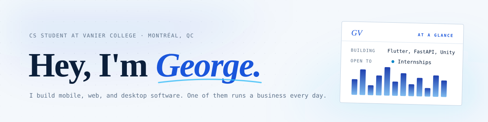

<picture>
  <source media="(prefers-color-scheme: dark)" srcset="https://raw.githubusercontent.com/gvogas/gvogas/main/assets/readme-banner-dark.svg" />
  
</picture>

  <a href="https://gvogas.github.io/gvogas/"><strong>Portfolio</strong></a> &nbsp; / &nbsp;
  <a href="https://www.linkedin.com/in/georgevogas/">LinkedIn</a> &nbsp; / &nbsp;
  <a href="https://devpost.com/Terminator320">Devpost</a>

Hi, I'm George. I study computer science at Vanier College and I'm looking for an internship.

Most of what I know I learned by building projects. A few of them have real users: a scheduling app a company uses every day, and a student tracker some of my classmates use. I'm also finishing an iPhone budgeting app for the App Store.

---

## Projects

### ES Pro

Mobile app · Client project · Private repo

A service company paid me to replace their paper schedule with an app. They've used it every day since I handed it over.

- Shared appointment calendar, color-coded by employee, with separate admin and employee roles
- Client directory with search that ignores accents
- Employees can only sign up if an admin has already added their email

<code>Flutter</code> <code>Dart</code> <code>Firebase</code> <code>Google Places API</code> <code>Android</code> <code>iOS</code>

More details

- Take photos in the app; they're compressed and uploaded to Firebase Storage in the background
- Light and dark mode, text size, and language settings that are saved between sessions
- Address autocomplete from the Google Places API

The code is organized by feature. Screens never talk to Firestore directly; each feature has a
service class that does. Right now I'm adding Wave billing so finished appointments turn into
invoices and payment status shows up in the app.

---

### [Term](https://github.com/gvogas/medDashboard)

Web app · Solo · 700+ commits

Tracks courses, timetables, deadlines, grades, and study time. A small group of my classmates use it. It works offline and syncs when you reconnect. [Live site](https://rounds.termanitor07.workers.dev)

- An "Up next" list tells you what to work on and why, e.g. "Exam in 4 days · worth 30% · 8 topics left"
- Upload a course outline, school calendar, or timetable screenshot and AI fills in your data. You review it before anything is saved.

<code>TypeScript</code> <code>React</code> <code>Tailwind</code> <code>Cloudflare Workers</code> <code>D1 (SQLite)</code> <code>IndexedDB</code> <code>Workers AI</code> <code>Vitest</code>

More details

- Grade calculator with weighted categories, drop-lowest rules, "what if" scores, and GPA by semester
- Shared classes and group projects with roles, invites, and an activity feed
- Calendar feed for Google or Apple Calendar, morning push notifications, undo, and JSON/CSV export
- Admin page with accounts, error logs, and switches to turn features off for maintenance

The app reads from IndexedDB in the browser and syncs with an API on Cloudflare Workers and D1.
Every push to `main` runs type checks, tests, and a build, applies database migrations, and
deploys with GitHub Actions. There's also a staging site for testing branches.

---

### [TicketMaestrix](https://github.com/gvogas/Ticketmaestrix)

Web app · Team of three

An event ticketing site I built with Fadwa Shalby and Lucas Coveyduck. Customers buy tickets; admins manage events and sales.

- Built with Slim (a PHP MVC framework) and Twig templates
- GitHub Actions deploys to cPanel on every push

<code>PHP</code> <code>Slim</code> <code>Twig</code> <code>MySQL</code> <code>Stripe</code> <code>GitHub Actions</code> <code>cPanel</code>

More details

- User accounts, ticket purchases with Stripe, and order history
- Admin dashboard for creating events, managing ticket stock, and viewing transactions
- Translations for multiple languages

---

### [Headroom](https://gvogas.github.io/Spending-Tracker-pages/)

iPhone app · Solo · Coming to the App Store

Tells you how much you can spend per day until payday. You enter your balance, payday, and bills. No account or bank login, and your data stays on your phone.

- Daily amount = (balance − bills due before payday − savings) ÷ days left
- Home screen widget, Apple Watch complications, and Siri support

<code>Swift</code> <code>iOS</code> <code>watchOS</code> <code>WidgetKit</code> <code>Siri Shortcuts</code>

More details

- "Can I afford this?" check that tells you whether a purchase fits
- Face ID lock, an option to hide amounts, and encrypted backups
- English and French, a one-time Pro purchase, and no tracking

---

### [AI Study Assistant](https://github.com/gvogas/AI-Study-Assistant)

Hackathon · MariHacks · Team of four

Turns notes, slides, or a topic into study guides, flashcards, and quizzes. You also get a plant that grows as you study. [Devpost](https://devpost.com/software/ai-study-assistant-giursf)

- Searches the web with Tavily and generates content with LLaMA 3.3 on Groq
- Builds study plans of up to 30 days and gives more time to topics you got wrong on quizzes

<code>Python</code> <code>FastAPI</code> <code>Groq</code> <code>Tavily</code> <code>SQLite</code> <code>JavaScript</code>

More details

- Accepts PDF, PowerPoint, text, and Markdown files
- Coins and upgrades; the plant heals on right answers and loses health on wrong ones
- Optional Spotify controls
- JWT login, rate limiting, encrypted Spotify tokens, and pytest tests

---

### Smart Self-Checkout

Hardware · Team of three · School project

A small self-checkout store running on a Raspberry Pi, built with Oliver D'Avino and Arend Markies. Customers scan items with RFID and pay with a membership card. An ESP32 monitors two fridges.

- The ESP32 reads temperature and humidity sensors and sends the data over MQTT
- If a fridge gets too warm, you get an email. Reply YES and the fan turns on.

<code>Python</code> <code>Flask</code> <code>Raspberry Pi</code> <code>ESP32</code> <code>MQTT</code> <code>RFID</code> <code>SQLite</code>

More details

- Emailed receipts and purchase history
- Admin pages for products, stock, and customers, with low-stock emails

I wrote the ESP32 and sensor code, the fan control, the fridge dashboard, the email alerts, and
the product, inventory, and checkout features.

## Skills

| Area | Tools |
| --- | --- |
| **Mobile** | Flutter, Dart, Swift, Firebase |
| **Web** | TypeScript, React, Tailwind, Python, FastAPI, Flask, PHP |
| **Hardware** | ESP32, Raspberry Pi, MQTT, RFID, C/C++ |
| **Databases and hosting** | Cloudflare Workers, MySQL, SQLite, Linux, GitHub Actions |

I've also used Java, C#, .NET, Unity, HTML, and CSS.

Outside of class I work on robotics (microcontroller firmware, PID control, sensor fusion). I also play hockey.

## Activity

My [portfolio](https://gvogas.github.io/gvogas/#city) has a 3D view of my GitHub contributions.

Contribution graph

<picture>
  <source media="(prefers-color-scheme: dark)" srcset="https://raw.githubusercontent.com/gvogas/gvogas/output/github-snake-dark.svg" />
  
</picture>

## Contact

I'm looking for an internship, but I'm also happy to just talk about projects. Message me on [LinkedIn](https://www.linkedin.com/in/georgevogas/).
